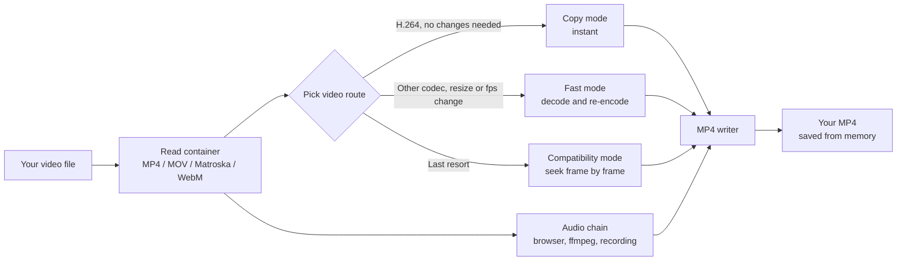

<div align="center">

# Video-MP4

**Convert videos to MP4, right in your browser.**
No account. No upload. No install. Everything is converted on your device.

</div>

---

## Table of contents

* [What is Video-MP4?](#what-is-video-mp4)
* [Highlights](#highlights)
* [Quick start](#quick-start)
* [How it works](#how-it-works)
* [Features in detail](#features-in-detail)
* [Use cases](#use-cases)
* [Options reference](#options-reference)
* [Security and privacy](#security-and-privacy)
* [Browser support and requirements](#browser-support-and-requirements)
* [Troubleshooting and FAQ](#troubleshooting-and-faq)
* [For developers](#for-developers)
* [Suggest a feature](#suggest-a-feature)
* [License](#license)

---

## What is Video-MP4?

Video-MP4 is a video converter that lives in **a single HTML file**. Open it in a browser, drop in one or more videos, press **Convert**, and save the MP4s. Your videos are read from disk and processed by the page itself. They are never uploaded to a server.

There is no sign-up, no installer, no app store and no backend to run. Video-MP4 is the whole app in one file: the interface, the file readers, the video and audio converters, the MP4 writer and an embedded copy of ffmpeg for hard-to-decode audio.

It also picks the fastest route for each video. If a video is already H.264, it is copied into the new MP4 untouched, which is instant and loses no quality. Otherwise it is re-encoded with your browser's own hardware or software encoder, with a slower compatibility route kept as a last resort.

---

## Highlights

|||
|-|-|
|**On-device conversion**|Videos are converted by your browser. Nothing is uploaded, and the app makes no network requests.|
|**Zero setup**|One HTML file. No account, no install, no server of your own, and it works offline.|
|**Instant copy mode**|Compatible H.264 video is copied straight into the MP4 with no re-encoding and no quality loss.|
|**Fast re-encoding**|Other codecs (HEVC, VP9, AV1 and more) are decoded and re-encoded with your browser's H.264 encoder, using hardware when available.|
|**Built-in audio decoder**|An embedded ffmpeg handles AC-3, E-AC-3, DTS, TrueHD and other formats the browser can't decode.|
|**Batch queue**|Add many videos at once. They convert one after another, and one failure never stops the rest.|
|**Quality controls**|Choose quality, max resolution, frame rate, audio bitrate and encoder type.|
|**Fast-start output**|The MP4 index is placed at the front, so the file starts playing before it has fully loaded.|
|**Large files**|Outputs over 4 GB use 64-bit offsets and stay valid.|
|**Audio never blocks a conversion**|If audio can't be converted, the video is still saved without sound, and the card tells you why.|
|**Dark, single-column UI**|A simple page that works down to phone width.|

---

## Quick start

### Option 1: just open the file

1. Download `Video-MP4-1_0_0.html` from this repository.
2. Open it in a recent **Chrome or Edge** on a computer (see [Browser support](#browser-support-and-requirements)).
3. Drag videos onto the drop area, or press **Choose videos**.
4. Press **Convert**.
5. When a video finishes, press **Save** next to it.

Keep the tab open and visible while it converts. Browsers slow down or pause background tabs, which can stall a conversion.

The file is about 43 MB because it carries its own audio decoder (see [The embedded ffmpeg](#the-embedded-ffmpeg)). It loads from disk, so this only affects the first open.

### Option 2: host it (for example on GitHub Pages)

Because Video-MP4 is one static file, you can host it anywhere that serves static files.

1. Put the file in your repository (rename it to `index.html` if you want it at the site root).
2. Turn on GitHub Pages for the repository.
3. Share the link.

> Hosting is optional. Opening the file straight from your computer works the same, with one exception: some browsers restrict background workers on pages opened from disk. If you see that message, see [Troubleshooting](#troubleshooting-and-faq).

### Converting your first video

1. Drop a video onto the drop area.
2. Check the card that appears. It shows the name, size and live status.
3. Press **Convert**.
4. Press **Save** when the card turns green.

---

## How it works

Video-MP4 reads the file, picks the fastest video route that will work, converts the audio at the same time, and writes a new MP4.



Everything runs in the page itself. Nothing leaves your device.

### 1. Reading the file

The app reads the file in 8 MB windows using `File.slice`, so it does **not** load a whole video into memory to look inside it. It has its own small parsers for two container families:

* **MP4 / MOV** (the `moov` box, with sample tables)
* **Matroska / WebM** (EBML, detected by the `1A 45 DF A3` header)

From those it learns the video codec, size, rotation and the position, timestamp and keyframe flag of every frame. Recognised video codecs are **H.264, HEVC (H.265), VP8, VP9 and AV1**. Whether a codec can be *decoded* depends on your browser.

### 2. Choosing a video route

The app picks the fastest route that will work and falls back automatically if it fails.

**Copy mode** (instant, original quality). The H.264 frames are copied straight from the source into the new MP4 with no decoding or encoding. Used only when **all** of these hold:

* "Copy as-is" is on
* the file is no larger than 1.5 GB
* the video is H.264 (`avc1`) in Baseline, Main or High profile
* the frame rate is constant and you did not pick a frame rate
* no resize is needed
* the video is not rotated

**Fast mode.** The browser's `VideoDecoder` decodes each frame, the frame is scaled on a canvas if needed, and the browser's `VideoEncoder` encodes it as H.264. Frames are placed on an exact, constant frame grid, repeating or dropping frames as needed. This is the normal route for HEVC, VP9, AV1, variable-frame-rate phone clips, and any resize or frame-rate change. It uses the hardware encoder when you ask for it and it exists.

**Compatibility mode.** The video is loaded into a hidden `<video>` element and the app seeks to one frame at a time, draws it, and encodes it. It is much slower, but it works for anything the browser can *play*, including rotated videos and containers the app's own parsers don't understand. It is the last resort.

If copy mode fails, the app tries fast mode. If that fails, it tries compatibility mode. The finished card says which mode was used.

### 3. Audio, at the same time

Audio is converted in parallel with the video. It always ends up as AAC-LC, 48 kHz, stereo. How it gets there depends on what the browser can decode:

1. **Browser decode (fastest).** The whole audio track is decoded with the Web Audio API and encoded to AAC with the browser's `AudioEncoder`. This covers AAC, MP3, Opus, Vorbis, FLAC, PCM and similar formats.
2. **ffmpeg (built in).** If the browser can't decode the audio, the embedded ffmpeg takes over. This is what makes **AC-3 (Dolby Digital), E-AC-3, DTS, TrueHD** and many other formats work. It needs no download and no internet.
3. **Real-time recording (last resort).** If ffmpeg also fails and the audio is something the browser *can* play, the app plays the file silently in a hidden video element and records the sound. This takes as long as the video lasts. It is **not** attempted for AC-3, DTS, TrueHD, MPEG-H or Dolby audio, because the browser can't play those, so you get a clear error instead.

If there is no audio track at all, the app detects this by looking inside the container and writes an MP4 with no audio.

### 4. Writing the MP4

A small MP4 writer built into the page takes the video frames and the AAC frames, interleaves them in one-second chunks, builds the sample tables, and writes the finished file with the index first. The result is a normal `Blob` that the **Save** button downloads.

---

## Features in detail

### Adding and queueing videos

* **Drag and drop** onto the dashed area, or use **Choose videos**. Several files at once are supported.
* **Accepted types** include MP4, MOV, MKV, WebM, M4V, 3GP, TS/MTS, OGV, AVI, FLV and WMV. Whether a file can actually be read depends on your browser (see [Limits](#limits-and-things-to-know)).
* **The queue.** Each video appears as a card showing its name, size and live status, with a thin progress bar.
* **Convert.** Videos convert one after another, in the order added.
* **Cancel.** Each running card has a **Cancel** button. A cancelled or failed video stays in the list with its message, and the rest carry on.
* **Clear.** Empties the list and frees the memory used by finished files. It is disabled while a conversion is running.

### Saving results

* **Save · size.** When a video finishes, its card shows a **Save** button with the file size. Click it to download the MP4.
* **Output names.** `holiday.mov` becomes `holiday.mp4`. A file that is already `.mp4` becomes `name-converted.mp4` so it never collides with the original.
* **Held in memory.** Finished files stay in memory until you press **Clear** or close the tab, so save files as you go.

### Skip audio

If the audio needs the slower fallback decoder, a **Skip audio** button appears on that card. Pressing it produces an MP4 without sound instead of waiting for the audio.

### Video routes

Copy mode, fast mode and compatibility mode (see [How it works](#2-choosing-a-video-route)). The finished card says which one was used, and the app falls back automatically if one fails.

### Audio chain

Browser decode, then ffmpeg, then real-time recording (see [How it works](#3-audio-at-the-same-time)). Audio problems never fail the whole conversion. If every step fails, or you press **Skip audio**, the video is still converted and saved without sound. The card's status line ends with "no audio" and the reason.

### What the output looks like

|Property|Value|
|-|-|
|Container|MP4, with the index (`moov`) at the front so it plays before it has fully loaded ("fast start")|
|Video|H.264 (AVC). The encoder tries **High**, then **Main**, then **Baseline** profile, with the level chosen automatically from the size and frame rate|
|Pixel format|8-bit YUV 4:2:0 (the format every device plays)|
|Frame rate|Constant when re-encoded. Keyframe about every 2 seconds|
|Audio|AAC-LC, 48 kHz, stereo, at the chosen bitrate. Videos with no audio track produce an MP4 with no audio|
|Large files|Files that need it use 64-bit offsets (`co64`) so outputs over 4 GB are valid|

### The embedded ffmpeg

The file contains a copy of **ffmpeg compiled to WebAssembly** (the kind of build used by the ffmpeg.wasm project). Its build string reports libavcodec 59.37, which belongs to the **FFmpeg 5.1** series. It was compiled with Emscripten using WebAssembly SIMD, and **without threads**, so it does not need `SharedArrayBuffer` or any special server headers and works when you just double-click the file.

It is stored as two blocks of base64 text near the end of the HTML:

|Block|Contents|Size|
|-|-|-|
|`<script type="text/plain" id="ffjs">`|the Emscripten JavaScript glue (about 115 KB)|about 150 KB as base64|
|`<script type="text/plain" id="ffwasm">`|the ffmpeg WebAssembly binary (about 32 MB)|about 42.8 MB as base64|

Base64 makes binary data about a third bigger, which is why the HTML is about 43 MB. The blocks are `type="text/plain"`, so the browser never tries to run them as scripts and ignores them until needed.

**When and how it runs**

* **Lazy.** The base64 is only decoded the first time a video's audio actually needs ffmpeg. Most conversions never touch it, and cost nothing.
* **In a Web Worker.** The glue code and a small worker script are combined into a Blob URL and started as a background worker, so ffmpeg never freezes the page. The binary is handed straight to the worker, so it makes no network request.
* **No whole-file copy.** The source file is mounted into ffmpeg's virtual file system (WORKERFS), so it reads the video from disk instead of loading it all into memory. If that mount isn't possible it falls back to copying the file in, which is refused above about 1.2 GB.
* **One job, then gone.** Each run starts a fresh worker and terminates it afterwards, which returns the memory.
* **Start-up has a 60-second timeout**, with a step-by-step status line (for example "Starting audio decoder: starting wasm…") if something goes wrong.

**What it is told to do.** ffmpeg is used **only for audio**. It never touches the video. The command is equivalent to:

```
ffmpeg -i <your file> -map 0:a:0 -vn -sn -dn -ac 2 -ar 48000 -c:a aac -b:a <bitrate>k -f adts out.aac
```

That means: take the first audio track, ignore video, subtitles and data, mix to stereo, resample to 48 kHz, encode as AAC at your chosen bitrate, and write a raw AAC (ADTS) stream. The page then splits that stream into individual AAC frames, builds the codec configuration from the header, and puts them into the MP4 itself. Progress comes from ffmpeg's own `time=` log lines and shows as "Converting audio with ffmpeg: m:ss / m:ss".

**What's compiled into it.** The build was configured with `--enable-gpl` and these libraries: **x264, x265, libvpx, libmp3lame, libtheora, libvorbis, libopus, libwebp, libfreetype, libfribidi, libass, libzimg** and **zlib**. The app does not use most of them. It only needs ffmpeg's audio decoders and its built-in AAC encoder. They are present because the core ships as one standard build.

**Can I remove it?** Technically yes. Deleting the two `ffjs` / `ffwasm` blocks would shrink the file to roughly 150 KB, and ordinary audio would still convert through the browser. Audio that only ffmpeg can decode (AC-3, DTS, TrueHD and so on) would then fail or lose its sound. This hasn't been tested, so treat it as an experiment and keep a copy of the full file.

---

## Use cases

* **Make a video play everywhere.** Turn MKV, MOV, WebM and other formats into an MP4 that plays on phones, TVs and editors.
* **Shrink a big recording.** Lower the quality or the max resolution to make a screen recording or camera clip much smaller.
* **Fix a phone clip that won't import.** Variable-frame-rate phone videos are re-encoded to a constant frame rate, which many editors prefer.
* **Convert HEVC or AV1 to H.264** for older devices, if your browser can decode the source.
* **Rescue the sound from AC-3, DTS or TrueHD** movie rips, which are converted to ordinary stereo AAC.
* **Batch-convert a folder** by dropping everything in at once and saving each file as it finishes.
* **Convert private footage** without sending it to anyone. Nothing leaves your device, and it works offline.
* **Instant re-wrap.** If your video is already H.264, copy mode puts it into an MP4 in seconds with no quality loss.
* **Learning and tinkering.** A small, readable example of WebCodecs, hand-written MP4 and Matroska parsers, an MP4 writer and a WebAssembly ffmpeg in plain JavaScript.

---

## Options reference

Open the **Options** section under the buttons. The one-line summary beside it shows your current choices. Settings apply to every video converted afterwards.

|Option|Choices|What it does|
|-|-|-|
|**Quality**|Good, **Great (default)**, Very high, Maximum|Sets the video bitrate when the video is re-encoded. The bitrate is *width × height × frame rate × a factor* (0.09, 0.15, 0.24, 0.38), kept between 0.8 and 100 Mbps. Higher means bigger files and fewer artefacts.|
|**Max resolution**|Keep original, **1080p (default)**, 720p, 480p|Limits the shorter side of the picture. Bigger videos are scaled down with the aspect ratio kept. Smaller videos are never scaled up.|
|**Frame rate**|**Match source (default)**, 24, 25, 30, 60|The frame rate of the output. "Match source" detects the original rate and snaps it to the nearest standard one (23.976, 24, 25, 29.97, 30, 48, 50, 59.94, 60).|
|**Audio bitrate**|128, **160 (default)**, 192 kbps|Bitrate of the AAC audio.|
|**Video already H.264?**|**Copy as-is (instant, default)**, Always re-encode|If the video is already a compatible H.264 stream, copy it untouched instead of re-encoding.|
|**Encoder**|**Hardware first (fastest, default)**, Software (smaller files)|Which H.264 encoder the browser should prefer. Hardware is faster. Software usually gives smaller files for the same quality. If the preferred kind isn't available the browser uses the other.|

Changing the frame rate, or picking a resolution that would shrink the video, turns off copy mode for that video, because the picture has to be re-encoded.

The defaults work for almost everyone. The other choices are for when you want smaller files, a specific frame rate, or a fix for a machine where something isn't working.

---

## Security and privacy

Video-MP4 is built around one idea: **your videos never leave your device.**

**What Video-MP4 does**

* The app's own code makes **no network requests**. There is no analytics, no tracking, no upload, no server and no account.
* Your videos are read from disk by the browser and processed in memory by the page. The finished MP4 is created in memory and handed to your browser's normal download.
* ffmpeg is not downloaded from anywhere. It is already inside the file.
* Nothing is stored. The app does not use cookies, local storage or a database, so when you close the tab everything is gone.

**What others can see**

* Nothing. There is no server and no other party in the process.

**What is stored on your device**

* Finished MP4s are held in memory until you press **Clear** or close the tab. You decide where they are saved when you press **Save**.

You can confirm all of this yourself by turning off your internet connection. The app works exactly the same.

> **If you share or host this file,** the embedded ffmpeg is a GPL-enabled build, so the licensing notes in [License](#license) apply.

---

## Browser support and requirements

* **A recent Chrome or Edge on a desktop or laptop.** These have the most complete support for the browser video and audio encoders this app relies on.
* The browser must support **WebCodecs** (`VideoEncoder`, `AudioEncoder`, `VideoFrame`). If it doesn't, the app shows a red warning at the top and the Convert button stays disabled.
* The browser needs an **H.264 encoder** for the size and frame rate you pick. Most desktop browsers have one, in hardware, in software, or both.
* **No internet connection** is needed to convert.
* **Keep the tab open and visible** while converting.

Other browsers may work partly or not at all. Phones and tablets are not a target.

### Limits and things to know

* **Browser support decides what can be read.** MP4, MOV, WebM and most MKV work. AVI, WMV and FLV usually do not, because browsers can't play them and the app's own parsers don't handle them.
* **Not every codec can be decoded.** HEVC (H.265), AV1 and VP9 depend on your browser and computer. If decoding isn't possible the video can't be converted.
* **Rotated phone videos** use compatibility mode, which is the slowest route.
* **Variable frame rate** videos (many phone recordings) are re-encoded to a constant frame rate rather than copied.
* **Copy mode is capped at 1.5 GB** per file. Larger files are re-encoded.
* **Audio from very large files.** The normal audio route reads the audio of the whole file at once, which can use a lot of memory. If it can't, the app moves on to ffmpeg, which streams from disk.
* **Results stay in memory.** Many large conversions add up. Press **Clear** to free memory, and save files as you go.
* **Real-time audio capture** (the last resort) takes as long as the video's length.
* **Encoder quality is the browser's.** Output quality and speed depend on the H.264 encoder your browser and hardware provide. Hardware encoders are quick but sometimes make larger files than software ones.
* **Subtitles, chapters and extra audio tracks are not carried over.** Only the first video track and the first audio track are converted.

---

## Troubleshooting and FAQ

**"This browser can't encode video (WebCodecs missing)".**
Use a recent Chrome or Edge on a computer.

**"This browser has no H.264 encoder for W×H".**
Lower the max resolution, switch Encoder to Software, or use Chrome or Edge.

**"Browser could not read this file".**
The format isn't supported by your browser. Try another browser, or convert the file to MP4 or WebM another way first.

**"No video track found".**
The browser can't decode this video. It may use a codec your computer lacks.

**"The browser would not start a background worker".**
Some browsers restrict workers on pages opened from disk. Serve the folder instead: run `python -m http.server` in it and open `http://localhost:8000/Video-MP4-1_0_0.html`.

**The audio decoder timed out or crashed.**
The video still converts, without sound, and the card says why. Close other heavy tabs and convert it again to retry the audio, or use **Skip audio** to stop waiting.

**"No audio (audio is AC-3/DTS… and the ffmpeg decoder failed)".**
The built-in decoder could not process that file's audio, so the MP4 was saved without sound. Try again in a fresh tab.

**"The browser blocked audio capture (click Convert again)".**
This only happens in the real-time fallback. Click Convert once more so the browser allows audio.

**"Audio playback stalled (keep this tab visible)".**
Keep the tab in the foreground during real-time capture.

**Conversion is very slow.**
Check the status line. "Compatibility mode" is the slow route. Using Chrome or Edge, a standard unrotated video and the Hardware encoder gets you to the fast routes.

**The output file is very large.**
Lower Quality or Max resolution, or switch Encoder to Software.

**Out of memory or the tab crashed.**
Convert one file at a time, **Clear** between files, and close other tabs.

**Is anything uploaded to a server?**
No. The app's own code makes no network requests, and you can turn off your internet connection to check.

**Do I need an account?**
No.

**Why is the file so big?**
About 43 MB of it is the embedded ffmpeg audio decoder, stored as base64 text. It is only decoded when a video's audio needs it.

---

## For developers

Video-MP4 is intentionally one self-contained file with no build step and no external dependencies.

### Running locally

Open the HTML file in a browser, or serve it with any static file server. There is nothing to install or compile.

### Structure

The whole app is `Video-MP4-1_0_0.html`. Inside it, in order:

1. **`<style>`**: the page design (dark theme, single centred column, responsive down to phone width).
2. **Markup**: title, drop area, queue list, buttons, the Options section, and a footer line.
3. **MP4 writer script**: builds the output file's boxes and tables.
4. **Demuxer script**: reads MP4/MOV and Matroska/WebM files.
5. **Main script**: the queue, the three video routes, the audio chain, the ffmpeg worker, and the small bit of code that keeps the Options summary line up to date.
6. **`ffjs` and `ffwasm` blocks**: the embedded ffmpeg (base64 text, never executed directly).

There are no external files, fonts, images, scripts or stylesheets. The page icon is an inline SVG.

### Serving over HTTP

If your browser blocks background workers on pages opened from disk, serve the folder with `python -m http.server` and open it on `http://localhost:8000/`.

### Slimming the file

Removing the `ffjs` and `ffwasm` blocks shrinks the file to roughly 150 KB, at the cost of audio formats only ffmpeg can decode. See [The embedded ffmpeg](#the-embedded-ffmpeg).

---

## Suggest a feature

Found a bug or have an idea? Open an issue on this repository's **Issues** tab.

Pull requests are welcome too. Keep Video-MP4 a single, dependency-free file where you can.

---

## License

<!-- Choose a license and add a LICENSE file, for example MIT. -->

Add your license here.

The conversion app and the ffmpeg core are different things with different licences.

* The ffmpeg core embedded in this file is a **GPL-enabled build** (it includes x264 and x265, among others). FFmpeg and those libraries are licensed by their own authors.
* If you only use the file yourself, there is nothing more to do. If you **share or distribute** the HTML file to other people, the GPL's terms apply to that embedded component, which generally means passing on the licence notices and making the corresponding source available. This is a summary, not legal advice. Check the licences of FFmpeg, x264 and x265 or ask someone qualified if you plan to distribute it.
* Video codecs such as H.264 and AAC are covered by patents in some regions and uses. Your browser's own encoders are what produce the video here, so their licensing is handled by the browser vendor.

---

<div align="center">
<sub>Made with care. Your videos never leave your device.</sub>
</div>
